<!-- ═══════════════════════════ HEADER ═══════════════════════════ -->
<div align="center">


<br/>


<br/><br/>

<a href="https://youtu.be/jNsRTWMScq4?si=5uziAg8HM-SrVYw0">
  
</a>

</div>

<br/>

<!-- ═══════════════════════════ NAV ═══════════════════════════ -->
<div align="center">

[**Showcase**](#showcase) &nbsp;•&nbsp;
[**Highlights**](#highlights) &nbsp;•&nbsp;
[**Architecture**](#architecture) &nbsp;•&nbsp;
[**Features**](#features) &nbsp;•&nbsp;
[**Tax Engine**](#tax-engine) &nbsp;•&nbsp;
[**API**](#rest-api) &nbsp;•&nbsp;
[**Security**](#security) &nbsp;•&nbsp;
[**Logging**](#logging) &nbsp;•&nbsp;
[**CI/CD**](#cicd--testing) &nbsp;•&nbsp;
[**Docker**](#docker) &nbsp;•&nbsp;
[**Get Started**](#getting-started)

</div>

---

## 📚 Contents

| | | |
|---|---|---|
| [📱 Showcase](#showcase) | [🧮 Tax Estimation Engine](#tax-engine) | [⚙️ CI/CD & Testing](#cicd--testing) |
| [✨ Highlights](#highlights) | [🌐 REST API](#rest-api) | [🔬 Static Analysis & Scans](#static-analysis) |
| [🏗️ Architecture](#architecture) | [🔐 Security & Data Integrity](#security) | [🐳 Docker Setup](#docker) |
| [🧩 Features by Role](#features) | [📡 Logging & Monitoring](#logging) | [🛠️ Getting Started](#getting-started) |
| [🔁 Booking & Payment Lifecycle](#lifecycle) | [🛡️ Final Security Review](#security-review) | [🧯 Troubleshooting](#troubleshooting) |
| [🗂️ Evidence Gallery](#evidence) | [⚠️ Known Limitations](#limitations) | [👥 Team](#team) |

---

<a id="showcase"></a>
## 📱 Showcase

<div align="center">

| 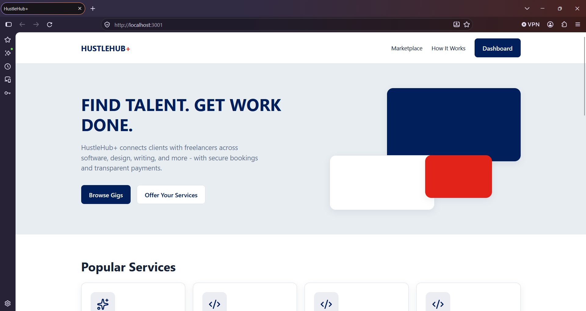 | 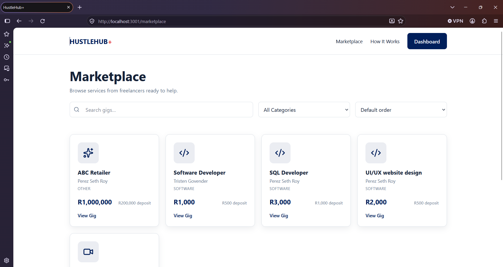 | 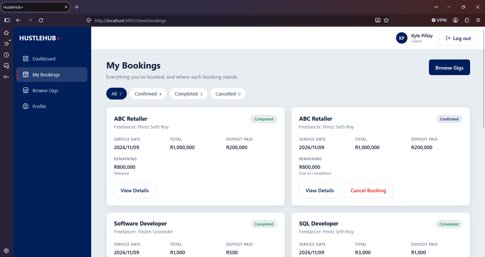 |
|:---:|:---:|:---:|
| **🏠 Landing Page**<br/><sub>Find talent. Get work done.</sub> | **🛍️ Marketplace**<br/><sub>Search, filter and browse gigs</sub> | **📅 My Bookings**<br/><sub>Track every engagement by status</sub> |

| 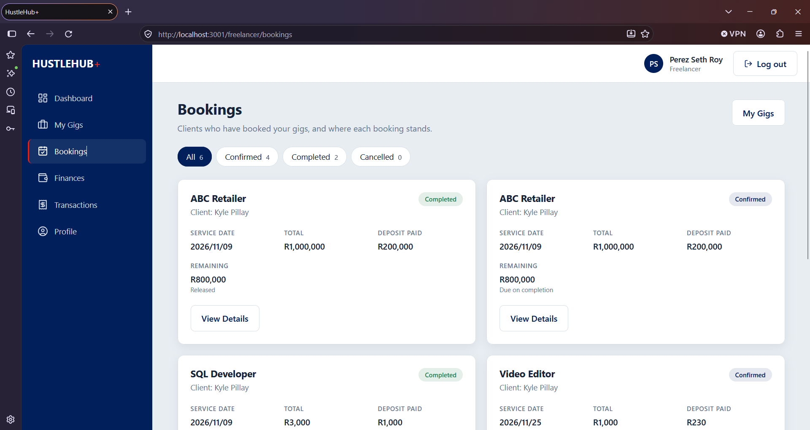 | 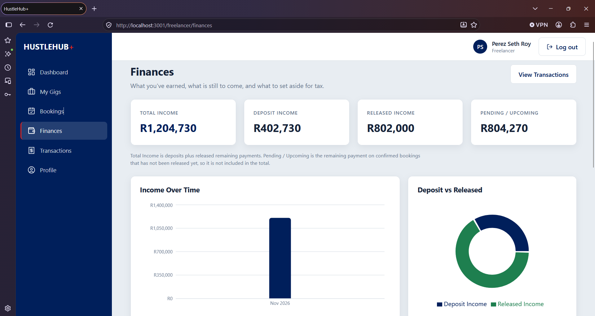 | 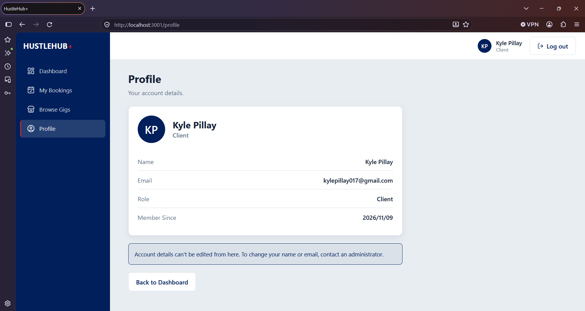 |
|:---:|:---:|:---:|
| **💼 Freelancer Bookings**<br/><sub>Manage client work</sub> | **📊 Finances**<br/><sub>Income, tax & payouts</sub> | **👤 Profile**<br/><sub>Read-only account details</sub> |

</div>

> 💡 Screenshots live in [`/images`](images). Filenames use underscores (no spaces) so they render reliably on GitHub.

---

<a id="highlights"></a>
## ✨ Highlights

<table>
<tr>
<td width="33%" valign="top">

### 🔐 Defence in Depth
JWT authentication, bcrypt hashing, RBAC, ownership checks, rate limiting, account lockout and token revocation, layered so no single control carries the whole load.

</td>
<td width="33%" valign="top">

### 🧮 Transparent Tax Engine
A freelancer-only `GET /income/tax` endpoint applies the SARS 2026/27 brackets and primary rebate to real paid transactions. The frontend only renders what the API returns.

</td>
<td width="33%" valign="top">

### ☁️ Cloud Logging
Every login attempt, booking, transaction and access-denied event is structured JSON, shipped in batches to **Better Stack**, searchable and alertable.

</td>
</tr>
<tr>
<td width="33%" valign="top">

### 🐳 Fully Containerised
MongoDB, API and frontend orchestrated by Docker Compose. Non-root users, dropped capabilities, multi-stage builds and healthcheck-enforced start order.

</td>
<td width="33%" valign="top">

### ⚙️ DevSecOps Pipeline
GitHub Actions runs Jest, Vitest, Newman, npm audit, Gitleaks, Semgrep, CodeQL and Trivy on every push. A broken check blocks the Docker stage.

</td>
<td width="33%" valign="top">

### 🧾 Real Financial Flow
Bookings create a deposit transaction immediately; completion releases the remainder. Transactions are read-only records created only by the backend.

</td>
</tr>
</table>

---

<a id="architecture"></a>
## 🏗️ Architecture

HustleHub+ follows a **layered MERN architecture**. The React frontend handles presentation, the Express API handles application logic and security, and MongoDB Atlas stores data through Mongoose. Separation of concerns keeps security, routing and business logic independently testable.

### System Overview

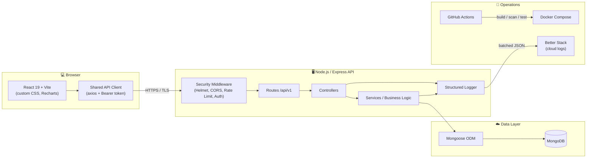

### Request Flow

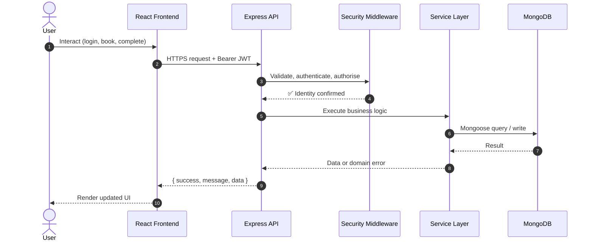

### Tech Stack

| Layer | Technology |
|---|---|
| **Frontend** | React 19 · Vite · React Router 7 · Recharts · custom CSS design tokens |
| **State** | Authentication context · one shared axios client · React Query (admin dashboard only) |
| **Backend** | Node.js 20.19+ · Express · layered routes → controllers → services |
| **Database** | MongoDB (Atlas or Docker) · Mongoose ODM |
| **Auth** | JWT (signed, 7-day expiry, unique `jti`) · bcrypt password hashing |
| **Security** | Helmet · CSP · CORS · rate limiting · account lockout · token revocation |
| **Logging** | Structured JSON → Better Stack (cloud) + console |
| **Testing** | Jest · Supertest · Vitest · React Testing Library · Newman |
| **CI/CD** | GitHub Actions · CodeQL · Gitleaks · Semgrep · Trivy · Dependabot |
| **Container** | Docker · Docker Compose · unprivileged nginx |

### Frontend Structure

```
frontend/src/
├── pages/       Screens grouped by audience: public, client, freelancer, admin
├── components/  Reusable UI: layout shells, forms, modals, tables, charts
├── services/    One shared API client + one module per backend resource
├── context/     Authentication state and the app-wide query cache
├── routes/      Route table and role-based route guards
├── utils/       Formatting, display helpers, derived-data logic
└── styles/      Design tokens and global styles
```

- **One API client.** A single axios instance attaches the bearer token, unwraps the `{ success, message, data }` envelope, normalises errors and handles expired sessions in one place. Components never import axios directly.
- **Route guards.** Role-based sidebar, a protected-route component, dedicated 403 and 404 pages, and a top-level error boundary that replaces a crashed screen with a generic error page.
- **Data presentation.** Amounts in whole rand (e.g. R2,500) and dates in the South African format. Every screen handles loading, empty and error states.

---

<a id="features"></a>
## 🧩 Features by Role

<details open>
<summary><b>👤 Visitor</b></summary>

<br/>

- Browse the marketplace, filter and search gigs, and view gig details.
- Register and log in. Registration can only create **Client** or **Freelancer** accounts. The Administrator role can never be self-assigned.

</details>

<details open>
<summary><b>🛍️ Client</b></summary>

<br/>

- Book gigs. The **deposit is recorded immediately** as a paid transaction.
- View all bookings with status filters (**Confirmed**, **Completed**, **Cancelled**).
- Open booking details with a progress timeline.
- Cancel a confirmed booking (the deposit is retained, the remainder is never released).
- Dashboard showing upcoming bookings and recent activity, plus a transaction history.

</details>

<details open>
<summary><b>💼 Freelancer</b></summary>

<br/>

- Create, edit and soft-delete gigs (deactivated gigs leave the marketplace; existing bookings are unaffected).
- See bookings made on each gig.
- **Mark a booking complete** once its service date arrives, which releases the remaining payment.
- Dashboard with an **Estimated Tax (YTD)** card, income summary with charts, and a full transaction history.
- **Tax estimation** via `GET /income/tax` using the SARS 2026/27 brackets.

</details>

<details open>
<summary><b>🛡️ Administrator</b></summary>

<br/>

- Live platform dashboard (statistics, bookings by status, recent activity) refreshed every 30 seconds.
- Manage users: edit name and role, delete users who have no history.
- Oversee all gigs, bookings and transactions.
- Admin accounts cannot be edited or deleted through the admin API.

</details>

<details open>
<summary><b>🔐 All signed-in users</b></summary>

<br/>

- Read-only profile page.
- Automatic session handling: expired or invalid tokens clear the session and redirect to a "session expired" page.
- A real server-side **logout** that revokes the token.

</details>

---

<a id="lifecycle"></a>
## 🔁 Booking & Payment Lifecycle

A booking is created as **CONFIRMED** and ends as either **COMPLETED** or **CANCELLED**. There is no pending state.

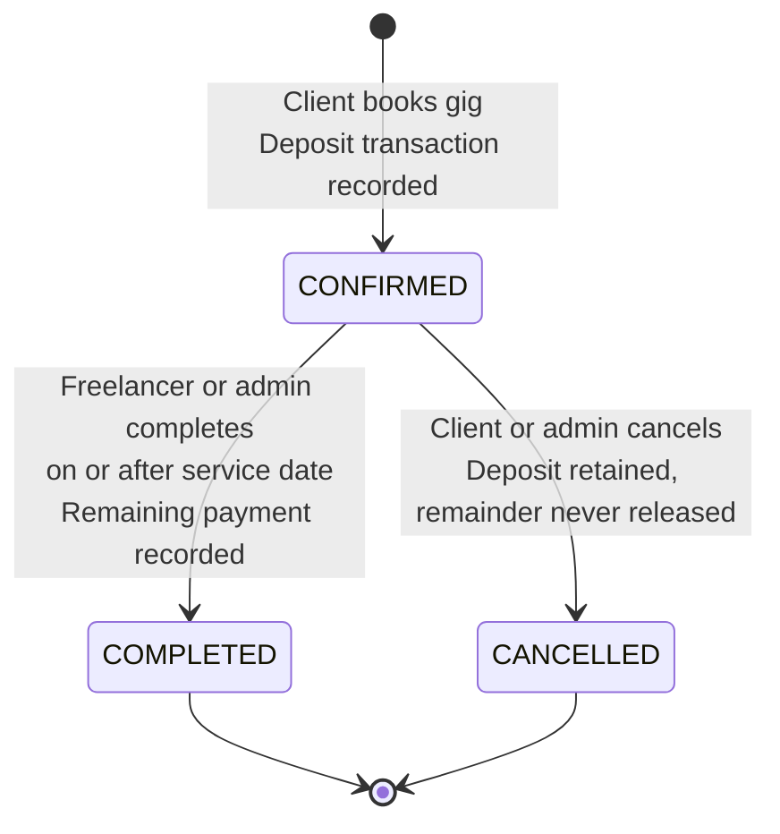

| Event | What the backend does |
|---|---|
| **Booking created** | Calculates amounts from the **gig's** price and deposit (never from the request) and records a **Deposit** transaction immediately. |
| **Booking completed** | Once the service date has arrived, records a **Remaining Payment** transaction. If recording fails, the completion is rolled back. |
| **Booking cancelled** | The deposit is retained and the remaining payment is never released. |

> All payments are simulated. Transactions are read-only records created only by the backend, and each is stored against the correct client and freelancer.

---

<a id="tax-engine"></a>
## 🧮 Tax Estimation Engine

The **main new feature** of the final part. A freelancer-only endpoint sums **paid** transactions for the current South African tax year (**1 March to end of February**), applies the SARS 2026/27 progressive brackets, then subtracts the primary rebate.

### How it works

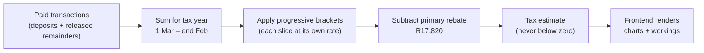

### Worked example: R300,000 of paid income

| Slice | Amount | Rate | Tax |
|---|---:|:---:|---:|
| First bracket | R245,100 | 18% | R44,118 |
| Second bracket | R54,900 | 26% | R14,274 |
| **Subtotal** | **R300,000** | | **R58,392** |
| **Less primary rebate** | | | **−R17,820** |
| **Estimated tax** | | | **R40,572** |
| **Take-home** | | | **R259,428** |
| **Effective rate** | | | **13.5%** |

### Assumptions

- Only **paid** transactions count. Pending or upcoming remainders on confirmed bookings are excluded until released.
- The tax year runs **1 March to the last day of February**.
- Each slice of income is taxed at **its own rate** (progressive, not a flat rate on the total).
- The **primary rebate of R17,820** is applied; tax **never goes below zero**, which gives a tax-free threshold of **R99,000** (R17,820 ÷ 18%).
- No other rebates, deductions, medical credits, or provisional-tax adjustments are modelled.
- This is an **estimate, not tax advice**.

> 📁 Bracket values live in `backend/src/config/taxConfig.js` and the logic in `taxCalculator.js`, so rates can be updated in exactly one place each tax year.

### Where it appears

- **Finances page:** taxable income, estimated tax, take-home pay and effective rate cards; a donut chart splitting take-home vs tax; a bar chart of tax by bracket; and a **"How is this calculated?"** panel showing the full working, with a disclaimer.
- **Dashboard:** an **Estimated Tax (YTD)** card.
- **Income cards:** Total, Deposit, Released and Pending / Upcoming income. Total income is deposits plus released remainders, and Pending is not included in the total.

> ⚠️ The frontend **never calculates tax itself**. It only displays what the API returns, so the logic lives in one place.

---

<a id="rest-api"></a>
## 🌐 REST API

All routes are versioned under **`/api/v1`** and served over HTTPS. Every response uses the envelope:

```json
{ "success": true, "message": "…", "data": { } }
```

| Resource | Base path | Access | Purpose |
|---|---|---|---|
| **Auth** | `/api/v1/auth` | Public / signed-in | Register, login, `me` (restore session), logout (revokes token) |
| **Gigs** | `/api/v1/gigs` | Public read · Freelancer write | List, view, create, edit, soft-delete (owner or admin only) |
| **Bookings** | `/api/v1/bookings` | Client / Freelancer / Admin | Create, list, view, complete, cancel (ownership enforced) |
| **Transactions** | `/api/v1/transactions` | Signed-in, scoped | Read-only history; each user sees only their own |
| **Income** | `/api/v1/income` | Freelancer | Income summary and **`GET /income/tax`** |
| **Admin** | `/api/v1/admin` | Admin | Users, platform statistics, oversight of all records |
| **Health** | `/health` | Public | Liveness check (used by Docker healthchecks) |

**Authenticated request**

```http
GET /api/v1/income/tax HTTP/1.1
Authorization: Bearer <jwt>
```

**Status codes you will see**

| Code | Meaning |
|:---:|---|
| `200` / `201` | Success / created |
| `400` | Validation failure (including rejected operator objects like `$ne`) |
| `401` | Missing, invalid, expired or **revoked** token ("This session has ended") |
| `403` | Wrong role or not the resource owner |
| `404` | Not found |
| `409` | Conflict (e.g. duplicate email) |
| `423` | **Account locked** after repeated failed logins |
| `429` | Rate limit reached |

A complete Postman collection lives in [`/postman`](postman) and is run with Newman (see [Testing](#cicd--testing)).

---

<a id="security"></a>
## 🔐 Security & Data Integrity

### Core Controls

| Control | Implementation |
|---|---|
| **Password security** | bcrypt hashing; strong password policy; plaintext never stored |
| **JWT authentication** | Signed tokens with 7-day expiry; server refuses to start without a ≥16-character secret |
| **Input validation** | Backend re-validates every request; frontend mirrors rules for instant feedback only |
| **Sanitisation & output encoding** | Trimmed text fields; React JSX escapes all output; no `dangerouslySetInnerHTML`; request bodies limited to 100 KB |
| **HTTPS/TLS** | Encrypted transport; production refuses to start without certificates |
| **RBAC** | Client / Freelancer / Admin enforced on backend routes |
| **Ownership checks** | Users can only touch their own gigs, bookings and transactions |
| **Rate limiting** | 300 requests / 15 min general · 100 on auth endpoints · 30 on booking creation |
| **Security headers** | Helmet + strict CSP; CORS restricted to a single configured origin |
| **Secure error handling** | No stack traces, paths, credentials or config values in responses |
| **Generic login errors** | A failed login never reveals whether the email or the password was wrong |
| **Frontend route guards** | Role-based sidebar and 403 page; backend remains authoritative |

### Additional Features (Final Part)

<table>
<tr>
<td width="33%" valign="top">

#### 🔒 Account Lockout
After **5 consecutive failed logins** an account locks for **15 minutes**. The lock is checked *before* the password is verified, so an attacker cannot keep guessing and learn when they get it right. It follows the account across IP addresses. Locked accounts get a `423`.

</td>
<td width="33%" valign="top">

#### 🚫 Token Revocation
Every JWT carries a unique ID (`jti`). Logging out adds that ID to a **denylist**, so a stolen token stops working immediately with a `401`. The denylist cleans itself with a MongoDB **TTL index**.

</td>
<td width="33%" valign="top">

#### 🛡️ Hardened Frontend
nginx sends a strict **Content Security Policy** (own-site scripts only), plus `nosniff`, frame-deny, referrer, permissions and cross-origin headers. nginx hides its version and only allows `GET` and `HEAD`.

</td>
</tr>
</table>

### Design Decisions Worth Knowing

- **Sanitise at the right place.** The backend trims text and normalises emails but deliberately does **not** HTML-escape before storing, because escaping at storage time corrupts legitimate characters (an `&` would be saved as `&amp;`). XSS protection is applied at **output**, where React encodes everything.
- **Authentication ≠ authorisation.** A valid Freelancer JWT proves who you are, not that you may touch another freelancer's gig. RBAC plus ownership checks close horizontal and vertical privilege escalation.
- **Amounts never come from the client.** Booking amounts are always read from the gig.
- **Administrative safeguards.** Admin role can't be chosen at registration; admin accounts can't be edited or deleted via the API; users with history can't be deleted; gig deletion is soft; cached admin data is wiped on logout.

---

<a id="logging"></a>
## 📡 Logging & Monitoring

Every entry is structured JSON written to the console and **shipped in batches to Better Stack**, so logs survive container restarts and can be searched and alerted on.

**Logged events:** successful and failed logins (with reason), account lockouts, bookings, every transaction created, access-denied events, authentication failures and server errors.

| Example event | Why it matters |
|---|---|
| `LOGIN_FAILED` | Repeated failures reveal **brute-force** attacks |
| `ACCOUNT_LOCKED` | Confirms lockout is protecting an account |
| `ACCESS_DENIED` | Reveals **privilege-escalation** probing |
| `TRANSACTION_CREATED` | Audit trail for money (amount and type) |

- **Meaningful severity:** `error` always means something in the system broke; normal rejections (bad input) are `warn`.
- **Redaction:** passwords, tokens and authorization headers are redacted before anything is written.
- **Request IDs:** each request gets an ID so a user's problem can be matched to exact log lines.

```bash
# See the console JSON output
docker compose logs backend --tail 10
```

---

<a id="cicd--testing"></a>
## ⚙️ CI/CD & Testing

The GitHub Actions workflow lives in `.github/workflows/ci.yml` and runs on every push and pull request.

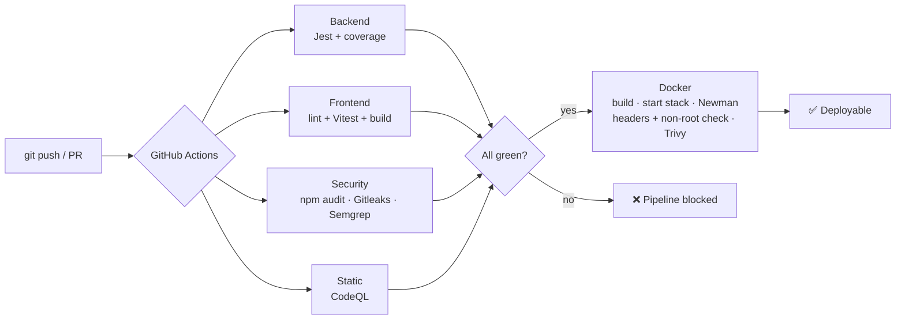

| Job | What it does |
|---|---|
| **Backend** | Installs dependencies and runs the Jest suite with coverage |
| **Frontend** | Installs, lints, runs Vitest and builds the production bundle |
| **Dependency audit** | `npm audit` for high and critical vulnerabilities |
| **Gitleaks** | Scans the **full git history** for committed secrets |
| **Semgrep** | Static analysis with JavaScript, Node.js and OWASP Top 10 rule packs |
| **CodeQL** | A second static-analysis opinion |
| **Docker** | Builds both images, starts the whole stack, waits for every service to be healthy, runs Newman against the live containers, verifies frontend security headers and the non-root user, then scans both images with **Trivy** |
| **Dependabot** | Opens weekly update pull requests |

> 🔴 **The pipeline really fails when a check fails.** A broken test turns the test job red and the Docker job is skipped, so nothing downstream runs.

### Test Suites

| Layer | Tooling | Coverage |
|---|---|---|
| **Backend** | Jest, Supertest, in-memory MongoDB | **154 tests**: auth, RBAC, gigs, bookings, transactions, income, tax calculator and API, logger, lockout and logout |
| **Frontend** | Vitest, React Testing Library | **109 tests**: rendering, interaction, finance page, tax failure and retry, logout |
| **API contract** | Postman collection via Newman | **97 requests, 200+ assertions**: success paths, validation errors, 400/401/403/404/409/423, injection attempts, ownership checks |
| **Static checks** | oxlint, production build | Code quality and compile-time errors |

> 🔁 The Newman collection generates **fresh user emails every run**, so it can be re-run against an existing database without cleanup.

---

<a id="static-analysis"></a>
## 🔬 Static Analysis & Scan Results

What the tools found, and how it was fixed.

| Tool | Finding | Fix |
|---|---|---|
| **Semgrep** | **18 findings**, all the same rule, all in **workflow files** (not app code): actions referenced by a movable tag can be silently repointed by their owner, a real supply-chain attack vector | Pinned **every action to a full commit SHA** |
| **npm audit** | Vulnerabilities from the old bcrypt installer chain, `body-parser` and axios's `follow-redirects` | Upgraded **bcrypt** and ran `npm audit fix`. Production dependencies now report **zero high/critical** issues |
| **Trivy** | **10 high findings**, none in our code. All in the copy of **npm bundled with the Node base image** | A production container never runs a package manager, so `npm`, `npx`, `corepack` and `yarn` are **removed from the runtime image** |
| **Gitleaks** | No secrets across the full git history | None needed |
| **CodeQL** | Second static-analysis opinion | Runs on every push |

---

<a id="docker"></a>
## 🐳 Docker Setup

Three services orchestrated by **Docker Compose**.

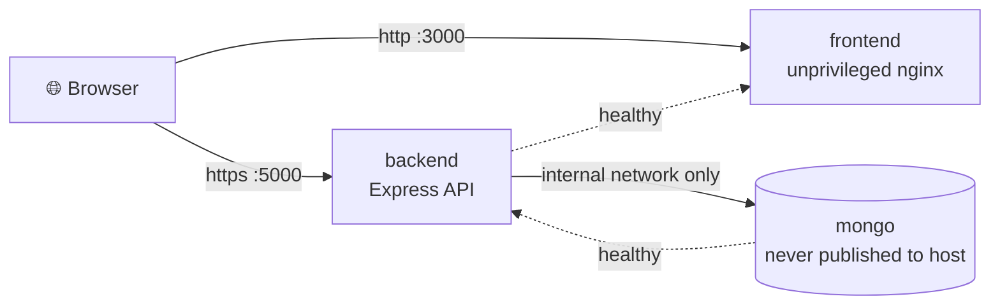

| Service | Details |
|---|---|
| **Database** | MongoDB on an **internal network only**, never published to the host |
| **Backend** | Express API over HTTPS · multi-stage build · production dependencies only · no package manager in the final image |
| **Frontend** | React served by an **unprivileged nginx** container |

**Hardening**

- Both application containers run as a **non-root user** with **all Linux capabilities dropped**.
- **Healthchecks enforce start order:** the API starts once the database is healthy; the frontend starts once the API is healthy.
- `npm`, `npx`, `corepack` and `yarn` are removed from the runtime image.

### Run it

```bash
# From the repository root: set up your environment values first (see Configuration)
docker compose up --build -d

# All three services should show "healthy"
docker compose ps

# Prove the API is not running as root (prints: node)
docker compose exec backend whoami
```

Then open **http://localhost:3000**.

```bash
# Verify the frontend security headers
curl -I http://localhost:3000

# Stop everything
docker compose down
```

> On Windows PowerShell use `curl.exe` instead of `curl`.

---

<a id="getting-started"></a>
## 🛠️ Getting Started

### Prerequisites

| Tool | Version |
|---|---|
| [Node.js](https://nodejs.org/) | **20.19+** (or 22.12+), required by the frontend's Vite toolchain |
| npm and Git | latest |
| [MongoDB Atlas](https://www.mongodb.com/atlas) | cluster, database user, and Network Access allowing your IP *(local dev)* |
| [OpenSSL](https://www.openssl.org/) | only if `backend/certificates/` is missing |
| [Docker](https://www.docker.com/) | for the containerised stack |

### Option A: Docker (recommended)

See [Docker Setup](#docker). One `docker compose up --build -d` starts the full stack.

### Option B: Local development

#### 1. Clone the repository

```bash
git clone <your-repository-url>
cd <repository-folder>   # contains backend/, frontend/ and postman/
```

#### 2. Backend

```bash
cd backend
npm install
```

Create your environment file (it is git-ignored, so a fresh clone does not have one):

```bash
# macOS / Linux
cp .env.example .env

# Windows PowerShell
Copy-Item .env.example .env
```

#### Configuration reference (`backend/.env`)

| Variable | Purpose |
|---|---|
| `PORT` | API port (default `5000`) |
| `NODE_ENV` | `development` locally, `production` in containers |
| `JWT_SECRET` | Token signing secret, **minimum 16 characters** (server refuses to start without it) |
| `JWT_EXPIRE` | Token lifetime (default `7d`) |
| `BCRYPT_ROUNDS` | Password hashing cost (default `10`) |
| `MONGODB_URI` | MongoDB connection string, ending in `/hustlehub` |
| `CLIENT_ORIGIN` | Frontend address, exactly `http://localhost:5173` locally or `http://localhost:3000` in Docker (no trailing slash). CORS allows this single origin |
| `ADMIN_NAME`, `ADMIN_EMAIL`, `ADMIN_PASSWORD` | Administrator account credentials |
| `SEED_ADMIN_ON_BOOT` | `true` creates that admin on startup. **Development only** |
| Better Stack source token / host | Credentials for shipping logs to Better Stack. **Never commit these**; see `.env.example` for the exact variable names |

#### HTTPS certificate

Certificates are git-ignored. If `backend/certificates/key.pem` and `cert.pem` do not exist, generate a self-signed pair (use `localhost` as the common name):

```bash
mkdir certificates
openssl req -x509 -newkey rsa:2048 -keyout certificates/key.pem -out certificates/cert.pem -days 365 -nodes
```

Start the API:

```bash
npm run dev
```

It runs at `https://localhost:5000`. Confirm with `https://localhost:5000/health`.

**Administrator account.** Registration can only create Clients and Freelancers. Create the admin with `npm run create-admin` (uses the `ADMIN_*` values), or set `SEED_ADMIN_ON_BOOT=true` for local development.

#### 3. Frontend

In a second terminal:

```bash
cd frontend
npm install
```

```bash
# macOS / Linux
cp .env.example .env

# Windows PowerShell
Copy-Item .env.example .env
```

`frontend/.env` holds the one setting the app needs:

```
VITE_API_BASE_URL=https://localhost:5000/api/v1
```

> Vite only reads `.env` on startup. Restart `npm run dev` after any change.

```bash
npm run dev
```

Open **http://localhost:5173**.

#### 4. Trust the local certificate (once per browser)

Open `https://localhost:5000/health` in the same browser, choose **Advanced → Proceed to localhost**, and confirm you see a JSON response. Without this step the browser blocks every API call with `ERR_CERT_AUTHORITY_INVALID`.

### 5. Try the full flow

1. Register a **Freelancer** and a **Client**, and keep the administrator login handy.
2. As the freelancer, create a gig with a price and a deposit.
3. As the client, open the gig in the marketplace and book it (the deposit is recorded immediately).
4. As the freelancer, open the booking and **Mark as Complete** on or after the service date. The remaining payment is released and appears in **Finances** and **Transactions**.
5. Open **Finances** and expand **"How is this calculated?"** to see your tax estimate.
6. As the administrator, watch the dashboard update and review users.

### Useful commands

| Where | Command | What it does |
|---|---|---|
| `backend` | `npm run dev` | Starts the API with automatic restart |
| `backend` | `npm test` | Runs the Jest + Supertest suite (154 tests) against an in-memory MongoDB |
| `backend` | `npm run test:newman` | Runs the Postman collection (97 requests) against the running API |
| `backend` | `npm run create-admin` | Creates the administrator account |
| `frontend` | `npm run dev` | Starts the Vite development server |
| `frontend` | `npm run build` | Produces a production build |
| `frontend` | `npm run lint` | Lints the frontend code |
| `frontend` | `npm test` | Runs the Vitest + React Testing Library suite (109 tests) |
| root | `docker compose up --build -d` | Starts the full containerised stack |
| root | `docker compose ps` | Shows service health |

---

<a id="security-review"></a>
## 🛡️ Final Security Review

Each common threat mapped to the controls that address it.

| Threat | How HustleHub+ defends |
|---|---|
| **Injection** (NoSQL / operator abuse) | Every input is validated; operator objects such as `$ne` are rejected with a `400`; typed Mongoose schemas; a Postman regression test proves it (e.g. `?category[$ne]=null`) |
| **Cross-site scripting (XSS)** | React escapes all output; no `dangerouslySetInnerHTML`; strict **CSP** from Helmet and nginx blocks injected scripts |
| **Broken authentication** | bcrypt hashing, strong password policy, signed expiring JWTs, generic login errors, rate limiting, **account lockout**, **token revocation** |
| **Broken access control** | Every protected route needs a valid token; roles enforced on routes; **ownership checks** in services; users cannot self-assign admin; denied attempts are logged as `ACCESS_DENIED` |
| **Sensitive data exposure** | HTTPS/TLS; passwords hashed; secrets and tokens redacted from logs; no stack traces or config in errors |
| **Security misconfiguration** | Helmet headers, single-origin CORS, nginx hides its version and allows only `GET`/`HEAD`, non-root containers, dropped capabilities, DB never published |
| **Vulnerable components** | `npm audit` in CI, Dependabot weekly PRs, Trivy image scans |
| **Insufficient logging** | Structured cloud logs for logins, lockouts, bookings, transactions, denials and errors, with request IDs |
| **Supply-chain risk** | GitHub Actions pinned to full commit SHAs, Gitleaks over full history, no package manager in runtime images |
| **Brute force / DoS** | Layered rate limits (300 / 100 / 30 per 15 min) and per-account lockout |

---

<a id="limitations"></a>
## ⚠️ Known Limitations

Documented honestly:

- **JWT in `localStorage`.** Unlike an HttpOnly cookie, scripts on the page can read it. This is a deliberate trade-off to keep sessions across refreshes, mitigated by output encoding, no raw HTML injection and a strict CSP. The token is sent only via the shared API client, cleared on logout and on any `401`, and expires automatically.
- **Self-signed certificate** for local HTTPS. Browsers need a one-time trust step; a real deployment would use a CA-issued certificate.
- **Simulated payments.** No real money moves.
- **Tax figures are estimates**, not tax advice, and model income only.
- **No server pagination or search.** Searching, filtering, sorting and dashboard statistics are derived in the browser from the lists the API returns.

---

<a id="evidence"></a>
## 🗂️ Evidence Gallery

Supporting screenshots are stored in [`docs/evidence`](docs/evidence).

| Evidence | What it shows |
|---|---|
| ✅ **Green pipeline run** | All GitHub Actions jobs passing |
| 🔴 **Failing demo run** | Red test job and skipped Docker job, proving a broken check blocks everything downstream |
| 🐳 **`docker compose ps`** | All three services `healthy`, and `whoami` printing `node` |
| 🧪 **Test summaries** | Backend (154), frontend (109) and Newman (97 requests, 0 failed) |
| 🔬 **Scan results** | Semgrep, Gitleaks, npm audit and Trivy output |
| 📡 **Better Stack** | Live tail showing `LOGIN_FAILED`, `ACCOUNT_LOCKED` and `TRANSACTION_CREATED` with no secrets |
| 🔒 **Security headers** | `curl -I` output showing CSP, `X-Frame-Options`, `X-Content-Type-Options` and no nginx version |
| 🚫 **Revoked token** | `401 "This session has ended"` after logout |

---

<a id="troubleshooting"></a>
## 🧯 Troubleshooting

| Symptom | Cause and fix |
|---|---|
| `ERR_CERT_AUTHORITY_INVALID` in the browser console | The self-signed certificate is not trusted yet. Open `https://localhost:5000/health`, choose **Advanced → Proceed**, then retry |
| `blocked by CORS policy` | `CLIENT_ORIGIN` must equal the browser address exactly (no trailing slash). After editing `backend/.env`, restart the backend |
| Requests go to `localhost:5173` and return 404 | `frontend/.env` is missing or Vite was not restarted after it was created |
| Backend exits with `querySrv ECONNREFUSED` | Some networks refuse the DNS lookup used by `mongodb+srv://` strings. The backend retries once using public DNS. If it still fails, use the standard `mongodb://` string from Atlas |
| `Server selection timed out` | Your IP address is not allowed in Atlas. Add it under **Network Access** |
| `Too many requests` (429) | A rate limit was reached. Wait up to 15 minutes; avoid keeping several admin dashboard tabs open (each polls every 30 s) |
| `423 account is locked` | 5 failed logins locked the account. Wait 15 minutes |
| `JWT_SECRET is missing or too short` | Set a `JWT_SECRET` of at least 16 characters |
| Docker service stuck `starting` | Start order is healthcheck-driven. Check `docker compose logs <service>` for the failing dependency |

---

<a id="team"></a>
## 👥 Team

Built by **Group 6** with four contributors, each working on their own branch and merging through pull requests into `main`, with structured commit messages throughout.

<div align="center">

**INSY7314 · Group 6 · 2026**

<sub>Built with React, Express and a lot of ☕</sub>


</div>
